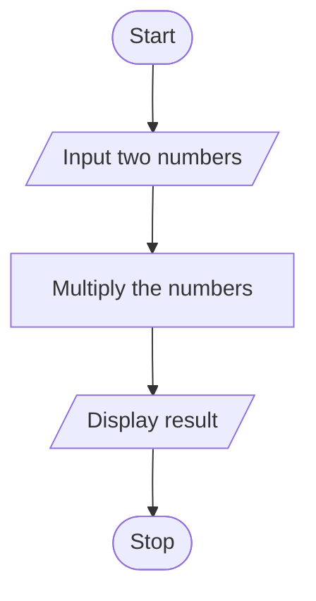
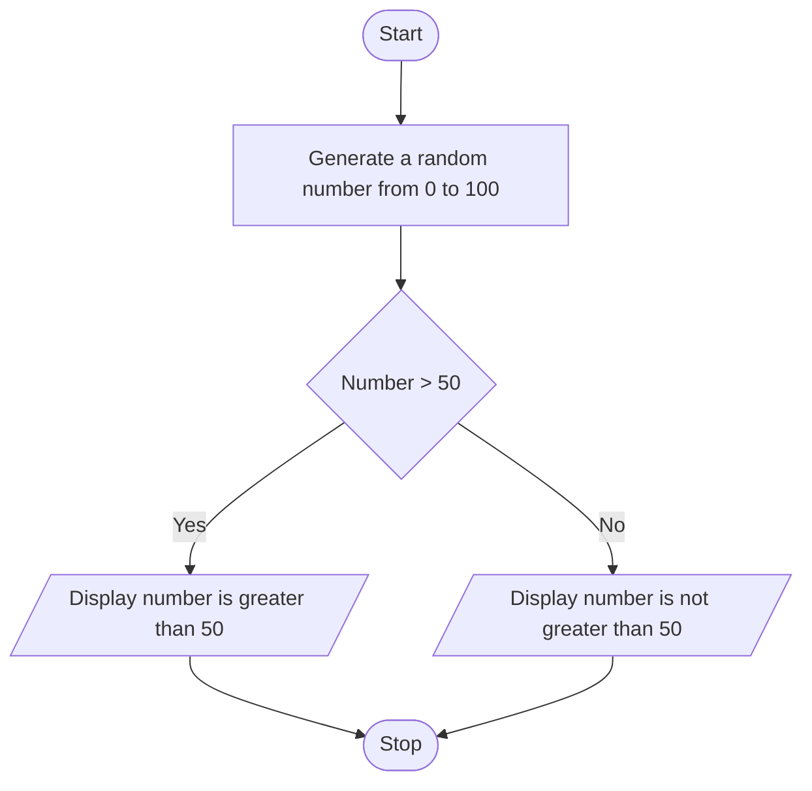
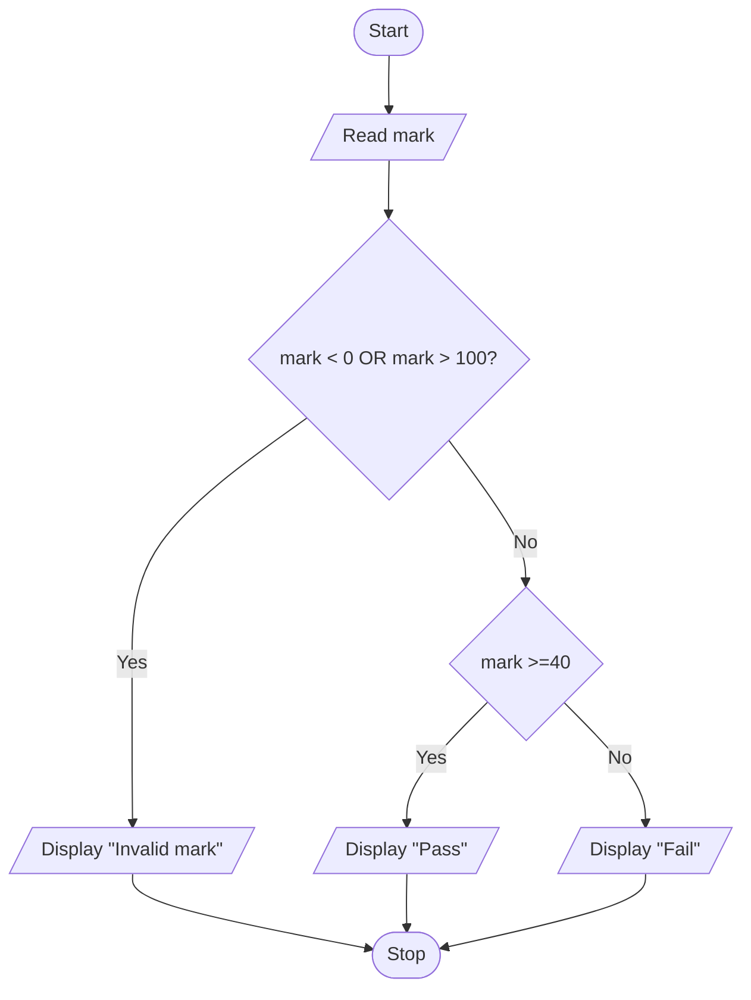
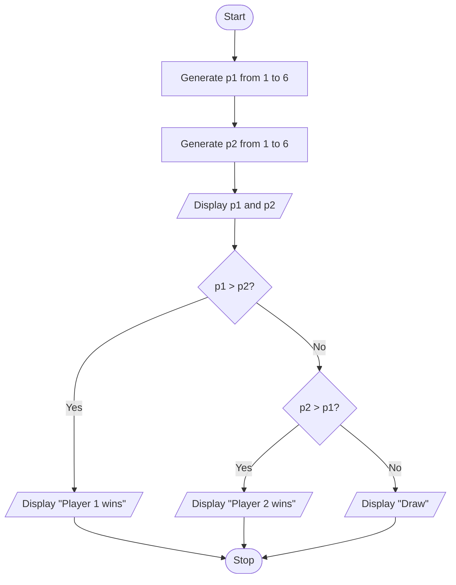
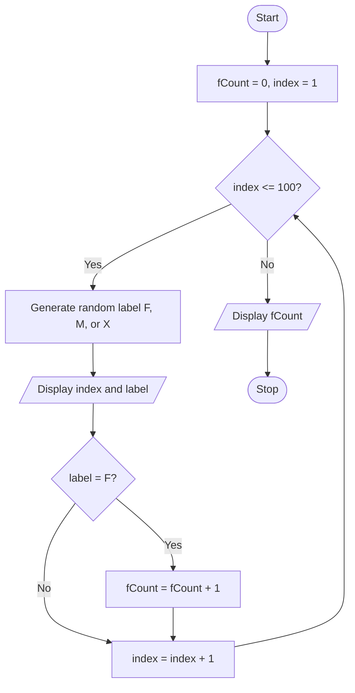

# Tutorial 01 — Answers


## Part I


### Question 1
**IPO Model**

| Input | Process | Output |
|---|---|---|
|first number, second number  |multiply first number by the second number  | product of the two numbers |

**Pseudocode**

```text
Start
read first number
read second number
result = first number *second number
print result
Stop
```

**Flowchart**



### Question 2

**IPO Model**

| Input | Process | Output |
|---|---|---|
|a random generated integer from 0 to 100 |compare the integer with 50 | greater than 50, or not greater than 50 |

**Pseudocode**

```text
Start
generate a random number from 0 to 100
if random number greater than 50
   print number is greater than 50
otherwise
   print number is not greater than 50
Stop
```

**Flowchart**



### Question 3

**IPO Model**

| Input | Process | Output |
|---|---|---|
|mark| Validate that mark is between 0 and 100; check whether mark >= 40  | Invalid mark, Pass ,or Fail |

**Pseudocode**

```text
Start
Read mark
If mark < 0 OR mark > 100
    Display "Invalid mark"
else if mark >= 40
    Display "Pass"
else
    Display "Fail"
end if
Stop
```

**Flowchart**



### Question 4

**IPO Model**

| Input | Process | Output |
|---|---|---|
|random generated Player1 dice value and Player2 dice value | Compare the two dice values |Both dice values and the winner or Draw |

**Pseudocode**

```text
Start
p1 = RANDOM_INTEGER(1, 6)
p2 = RANDOM_INTEGER(1, 6)
Display p1, p2
If p1 > p2 THEN
    Display "Player 1 wins"
else if p2 > p1
    Display "Player 2 wins"
else
    Display "Draw"
end if
Stop
```

**Flowchart**



### Question 5

**IPO Model**

| Input | Process | Output |
|---|---|---|
|length and width of a rectangle |Validate the length and width are positive, calculate perimeter = 2*(length+width) |perimeter or an invalid-dimensions message |

**Pseudocode**

```text
Start
Read length, width
If length <= 0 OR width <= 0
    Display "Invalid dimensions"
Else
    perimeter = 2*(length + width)
    Display perimeter
End if
Stop
```

**Flowchart**

```mermaid
flowchart TD
    A([Start]) --> B[/Read length and width/]
    B --> C{length <= 0 OR width <= 0}
    C --> |Yes| D[/Display "Invalid dimensions"/]
    C --> |No| E[perimeter = 2*(length + width)]
    E --> F[/Display perimeter/]
    D --> G([Stop])
    F --> G
```

### Question 6

**IPO Model**

| Input | Process | Output |
|---|---|---|
| 10 randomly generated integers from 0 to 100| Display each number and update the minimum whenever a smaller number is found|10 generated numbers and the minimum value |

**Pseudocode**

```text
Start
min = RANDOM_INTEGER(0, 100)
display min
count=1
While count < 10
    n = RANDOM_INTEGER(0, 100)
    display n
    If n < min
        min = n
    end if
    count = count + 1
end while
display min
Stop
```

**Flowchart**

```mermaid
flowchart TD
    A([Start]) --> B[min = RANDOM_INTEGER(0, 100)]
    B --> C[/Display min/]
    C --> D[count=1]
    D --> E{count <10?}
    E --> |Yes| F[n = RANDOM_INTEGER(0, 100)]
    F --> G[/Display n/]
    G --> H{n < min?}
    H --> |Yes| I[min = n]
    H --> |No| J[count = count + 1]
    I --> J
    J --> E
    E --> |No| K[/Display min/]
    K --> L([Stop])
```

### Question 7

**IPO Model**

| Input | Process | Output |
|---|---|---|
| 10 randomly generated integers from 10 to 100 inclusive| Check whether each number is even or odd using n MOD 2; increment even or odd|the 10 numbers, odd count and even count|

**Pseudocode**

```text
Start
even = 0
odd = 0
count = 0
While count < 10 
    n = RANDOM_INTEGER(10, 100)
    display n
    If n % 2 == 0
        even = even + 1
    else
        odd = odd + 1
    end if
    count = count + 1
end while
display even, odd
Stop
```

**Flowchart**

```mermaid
flowchart TD
    A([Start]) --> B[even = 0, odd = 0, count = 0 ]
    B --> C{count < 10?}
    C --> |Yes| D[n = RANDOM_INTEGER(10, 100)]
    D --> E[/Display n/]
    E --> F{n % 2 == 0?}
    F --> |Yes| G[even=even + 1]
    F --> |No| H[odd=odd+1]
    H --> I[count=count+1]
    G --> I
    I --> C
    C --> |No| J[/Display even, odd/]
    J --> K([Stop)]
```

## Part II


### Question 8

**IPO Model**

| Input | Process | Output |
|---|---|---|
|one sentence from user|Examine each character and count the occurrences of uppercase U and uppercase M | |

**Pseudocode**

```text
Start
Read sentence from user
uCount=0
mCount=0
index=0
While index < LENGTH(sentence)
    charac = CHARACTER_AT(sentence, index)
    If charac = 'U'
        uCount = uCount + 1
    else if charac = 'M'
        mCount = mCount + 1
    end if
    index = index + 1
end while
Display uCount, mCount
Stop
```

**Flowchart**

```mermaid
flowchart TD
    A([Start]) --> B[/read sentence/]
    B --> C[uCount = 0, mCount = 0, index = 0]
    C --> D{index < LENGTH(sentence)?}
    D --> |Yes| E[charac = CHARACTER_AT(sentence, index)]
    E --> F{charac = 'U'?}
    F --> |Yes| G[uCount = uCount + 1]
    F --> |No| H{charac = 'M'?}
    H --> |Yes| I[mCount = mCount + 1]
    H --> |No| J[index = index + 1]
    G --> J
    I --> J
    J --> D
    D -->|No| K[/Display uCount and mCount/]
    K --> L([Stop])
```

### Question 9

**IPO Model**

| Input | Process | Output |
|---|---|---|
|one keyword from user and extracted page text| Convert text and keyword to lowercase, split text into words, and count exact matches|Keyword and its frequency |

**Pseudocode**

```text
Start
Read pageText, keyword
keyword = LOWERCASE(keyword)
pageText = LOWERCASE(pageText)
words = SPLIT pageText into words
count = 0
position = 0
While position < LENGTH(words)
    If words[position]= keyword
        count = count + 1
    end if
    position =position +1
end while
Display keyword, count
Stop
```

**Flowchart**

```mermaid
flowchart TD
    A([Start]) --> B[/Read pageText and keyword/]
    B --> C[Convert pageText and keyword to lowercase]
    C --> D[Split pageText into words]
    D --> E[count = 0, position = 0]
    E --> F{position < LENGTH words?}
    F -->|Yes| G{words[position] = keyword?}
    G -->|Yes| H[count = count + 1]
    G -->|No| I[position = position + 1]
    H --> I
    I --> F
    F -->|No| J[/Display keyword and count/]
    J --> K([Stop])
```

### Question 10

**IPO Model**

| Input | Process | Output |
|---|---|---|
|100 randomly students labelled F,M or X |Check each label; count F records | The records and the F count|

**Pseudocode**

```text
Start
fCount = 0
FOR index FROM 1 TO 100 
    label = RANDOM_CHOICE('F', 'M', 'X')
    Display index, label
    IF label = 'F'
        fCount = fCount + 1
    end if
END FOR
Display fCount
Stop
```

**Flowchart**



### Question 11

**IPO Model**

| Input | Process | Output |
|---|---|---|
|5 generated integers |Sort the array ascending; traverse it backwards | A descending list|

**Pseudocode**

```text
Start
Generate five random integers
SORT numbers in ascending order
index = LENGTH(numbers) - 1
WHILE index >= 0
    DISPLAY numbers[index]
    index = index - 1
END WHILE
Stop
```

**Flowchart**

```mermaid
flowchart TD
    A([Start]) --> B[Generate five random integers]
    B --> C[Sort numbers in ascending order]
    C --> D[index = LENGTH(numbers) - 1]
    D --> E{index >= 0?}
    E -->|Yes| F[/Display numbers[index]/]
    F --> G[index = index - 1]
    G --> E
    E -->|No| H([Stop])
```

### Question 12

**IPO Model**

| Input | Process | Output |
|---|---|---|
|a random target and guesses |Compare guess with target; repeat while unequal|Higher, Lower, or Correct; attempt count|

**Pseudocode**

```text
Start
target = RANDOM_INTEGER(1, 100)
attempts = 0
REPEAT
    READ guess
    IF guess < 1 OR guess > 100
        DISPLAY "Enter 1–100"
    ELSE
        attempts = attempts + 1
        IF guess < target THEN
            DISPLAY "Higher"
        ELSE IF guess > target THEN
            DISPLAY "Lower"
        ELSE
            DISPLAY "Correct", attempts
        END IF
    END IF
UNTIL guess = target
Stop
```

**Flowchart**

```mermaid
flowchart TD
    A([Start]) --> B[target = RANDOM_INTEGER(1, 100)]
    B --> C[attempts = 0]
    C --> D[/Read guess/]
    D --> E{guess < 1 OR guess > 100?}
    E -->|Yes| F[/Display Enter 1–100/]
    F --> D
    E -->|No| G[attempts = attempts + 1]
    G --> H{guess < target?}
    H -->|Yes| I[/Display Higher/]
    H -->|No| J{guess > target?}
    J -->|Yes| K[/Display Lower/]
    J -->|No| L[/Display Correct and attempts/]
    I --> M{guess = target?}
    K --> M
    M -->|No| D
    M -->|Yes| N([Stop])
    L --> N
```

```
